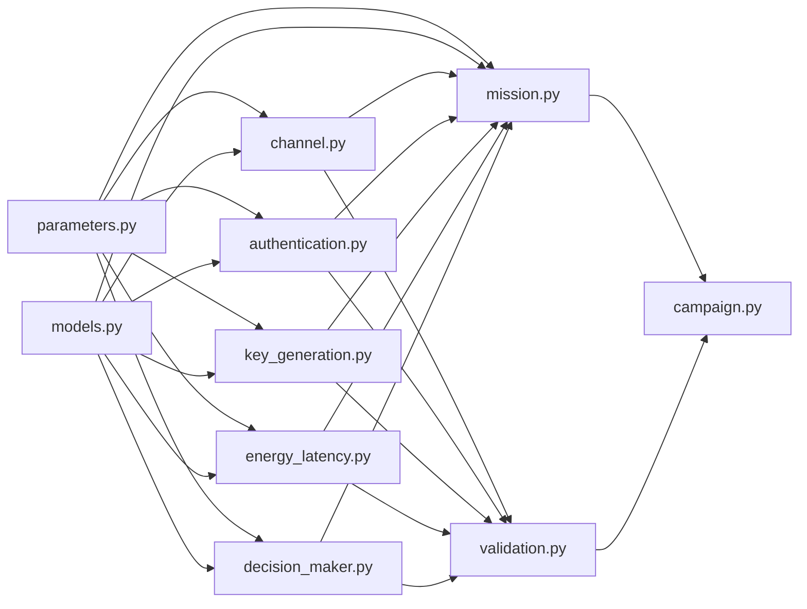
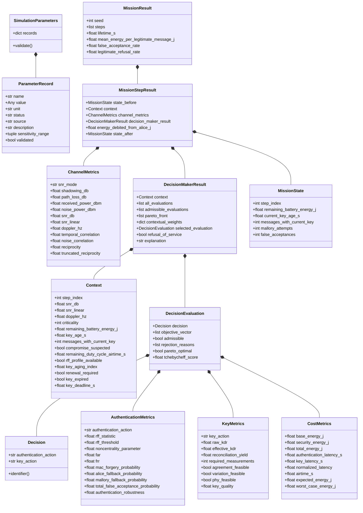
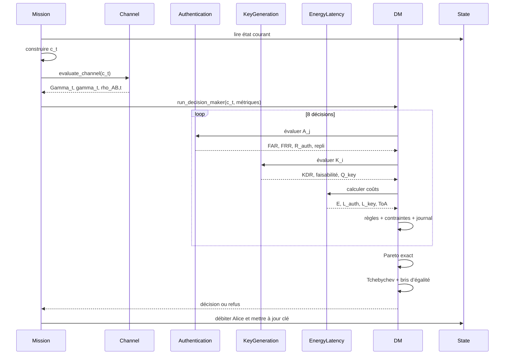
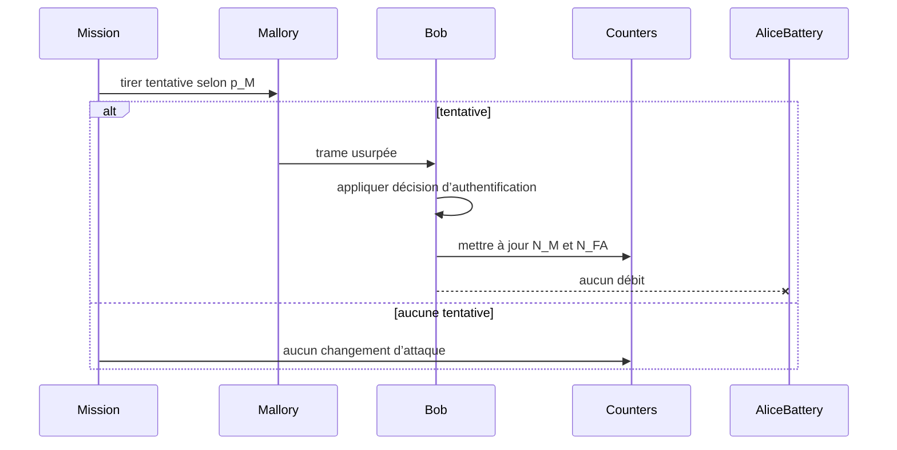

# UML scientifique et logiciel de PHYSEC-DM

## 1. Source de vérité

Ce document est aligné sur :

```text
modelisation_parametres_modifies(1).tex
modelisation parametre modifié.pdf
```

Les modules officiels sont :

```text
parameters
channel
authentication
key_generation
energy_latency
decision_maker
mission
validation
campaign
```

---

## 2. Vue des modules



---

## 3. Structures principales

```text
ParameterRecord
SimulationParameters
Context
ChannelMetrics
AuthenticationMetrics
KeyMetrics
CostMetrics
Decision
DecisionEvaluation
DecisionMakerResult
MissionState
MissionStepResult
MissionResult
CampaignResult
```

---

## 4. `ParameterRecord`

### Attributs

```text
name
value
unit
status
source
description
sensitivity_range
validated
```

### Statuts

```text
literature
datasheet
derived
calibrated
scenario
policy
to_validate
```

---

## 5. `SimulationParameters`

### Paramètres radio

```text
carrier_frequency_hz
bandwidth_hz
noise_figure_db
tx_power_dbm
tx_antenna_gain_dbi
rx_antenna_gain_dbi
system_loss_db
reference_distance_m
reference_path_loss_db
path_loss_exponent
shadowing_std_db
probe_delay_s
hardware_reciprocity
```

### Paramètres RFF

```text
rff_feature_count
mallory_separation
rff_threshold
target_frr
mac_tag_bits
rff_processing_time_bob_s
rff_profile_available
```

### Paramètres SKG

```text
maximum_kdr
minimum_correlation
key_length_bits
guard_band_factor
kept_measurement_ratio
dedicated_probe_interval_s
quantization_mode
variation_metric_validated
```

### Paramètres de cryptopériode

```text
maximum_key_age_s
maximum_messages_per_key
renewal_trigger
minimum_deadline_s
```

### Paramètres énergie/mission

```text
supply_voltage_v
tx_current_a
rx_current_a
cpu_current_a
cpu_frequency_hz
radio_sleep_current_a
mcu_sleep_current_a
battery_leak_current_a
initial_battery_energy_j
minimum_battery_energy_j
message_period_s
critical_message_probability
mallory_attempt_probability
```

### Méthode

```text
validate()
```

---

## 6. `Context`

### Attributs

```text
step_index
snr_db
snr_linear
doppler_hz
criticality
remaining_battery_energy_j
key_age_s
messages_with_current_key
compromise_suspected
remaining_duty_cycle_airtime_s
rff_profile_available
key_aging_index
renewal_required
key_expired
key_deadline_s
```

Le contexte est immuable pendant l’évaluation des huit décisions.

---

## 7. `ChannelMetrics`

### Attributs

```text
snr_mode
shadowing_db
path_loss_db
received_power_dbm
noise_power_dbm
snr_db
snr_linear
doppler_hz
temporal_correlation
noise_correlation
reciprocity
truncated_reciprocity
```

### Règles

- `reciprocity` est la valeur signée nominale ;
- `truncated_reciprocity` est optionnelle ;
- aucune valeur absolue n’est appliquée au modèle nominal.

---

## 8. `AuthenticationMetrics`

### Attributs

```text
authentication_action
rff_statistic
rff_threshold
noncentrality_parameter
far
frr
mac_forgery_probability
alice_fallback_probability
mallory_fallback_probability
total_false_acceptance_probability
authentication_robustness
expected_energy_j
worst_case_energy_j
expected_latency_s
worst_case_latency_s
```

### Sens par action

#### A1

```text
far = 2^(-b_MAC) pour la contrainte de sécurité
authentication_robustness = 1 - 2^(-b_MAC)
```

#### A2

```text
far = FAR RFF pour le plancher de sécurité
total_false_acceptance_probability =
    FAR + (1 - FAR) * 2^(-b_MAC)
authentication_robustness =
    1 - total_false_acceptance_probability
```

---

## 9. `KeyMetrics`

### Attributs

```text
key_action
raw_kdr
effective_kdr
binary_entropy
reconciliation_yield
required_measurements
agreement_feasible
variation_feasible
phy_feasible
key_aging_index
renewal_required
key_expired
key_deadline_s
key_quality
expected_energy_j
worst_case_energy_j
key_latency_s
```

---

## 10. `CostMetrics`

### Attributs

```text
base_energy_j
security_energy_j
total_energy_j
authentication_latency_s
key_latency_s
normalized_latency
airtime_s
expected_energy_j
worst_case_energy_j
expected_latency_s
worst_case_latency_s
```

---

## 11. `Decision`

### Attributs

```text
authentication_action
key_action
```

### Identifiant

```text
A1-K0
A1-K1a
A1-K1b
A1-K2
A2-K0
A2-K1a
A2-K1b
A2-K2
```

---

## 12. `DecisionEvaluation`

### Attributs

```text
decision
authentication_metrics
key_metrics
cost_metrics
objective_vector
reasoning_rules_ok
resource_constraints_ok
security_constraint_ok
admissible
rejection_reasons
pareto_optimal
normalized_objectives
tchebycheff_score
```

---

## 13. `DecisionMakerResult`

### Attributs

```text
context
all_evaluations
admissible_evaluations
pareto_front
rejection_journal
contextual_weights
ideal_point
nadir_point
selected_evaluation
refusal_of_service
explanation
```

---

## 14. `MissionState`

### Attributs

```text
step_index
remaining_battery_energy_j
current_key_age_s
messages_with_current_key
current_key_identifier
remaining_duty_cycle_airtime_s
legitimate_messages
legitimate_refusals
mallory_attempts
false_acceptances
critical_mallory_attempts
critical_false_acceptances
security_floor_violations
```

---

## 15. `MissionStepResult`

### Attributs

```text
state_before
context
channel_metrics
decision_maker_result
legitimate_service_result
mallory_attempted
mallory_accepted
energy_debited_from_alice_j
state_after
```

---

## 16. `MissionResult`

### Attributs

```text
parameters_snapshot
seed
steps
lifetime_s
mean_energy_per_legitimate_message_j
false_acceptance_rate
critical_false_acceptance_rate
legitimate_refusal_rate
security_floor_violation_rate
decision_counts
final_state
```

---

## 17. Diagramme de classes



---

## 18. Interface de `channel.py`

```text
compute_snr_linear()
snr_db_to_linear()
snr_linear_to_db()
generate_imposed_snr_db()
sample_shadowing_db()
compute_path_loss_db()
compute_received_power_dbm()
compute_noise_power_dbm()
compute_snr_db()
compute_empirical_correlation()
compute_doppler_hz()
compute_temporal_correlation()
compute_noise_correlation_factor()
compute_reciprocity()
compute_truncated_reciprocity()
evaluate_channel()
```

Signature principale :

```python
evaluate_channel(
    context,
    parameters,
    rng
) -> ChannelMetrics
```

---

## 19. Interface de `authentication.py`

```text
build_rff_vector()
sample_rff_observation()
estimate_rff_reference()
compute_mahalanobis_statistic()
apply_rff_test()
compute_noncentrality()
compute_frr()
compute_far()
compute_rff_noise_variance()
compute_noncentrality_from_snr()
compute_rff_threshold()
compute_mac_forgery_probability()
compute_a1_robustness()
compute_a2_false_acceptance()
compute_a2_robustness()
compute_alice_fallback_probability()
compute_mallory_fallback_probability()
evaluate_authentication_action()
```

---

## 20. Interface de `key_generation.py`

```text
compute_raw_kdr()
derive_minimum_correlation()
compute_effective_kdr()
compute_calibrated_kdr()
binary_entropy()
compute_reconciliation_yield()
compute_required_measurements()
check_agreement_feasibility()
check_phy_feasibility()
compute_key_aging_index()
is_renewal_triggered()
is_key_expired()
compute_key_deadline_s()
compute_k0_quality()
compute_phy_key_quality()
compute_k2_quality()
evaluate_key_action()
```

---

## 21. Interface de `energy_latency.py`

```text
compute_lora_symbol_time_s()
compute_lora_airtime_s()
compute_tx_energy_j()
compute_rx_energy_j()
compute_cpu_energy_j()
compute_base_energy_j()
compute_a1_cost()
compute_challenge_response_cost()
compute_a2_cost()
compute_reconciliation_cost()
compute_k0_cost()
compute_k1a_cost()
compute_k1b_cost()
compute_k2_cost()
compute_normalized_latency()
combine_decision_costs()
```

---

## 22. Interface de `decision_maker.py`

```text
build_decision_space()
check_reasoning_rules()
check_phy_constraint()
check_battery_constraint()
check_auth_latency_constraint()
check_key_deadline_constraint()
check_duty_cycle_constraint()
check_far_floor()
build_admissible_set()
build_objective_vector()
dominates()
compute_pareto_front()
compute_contextual_weights()
compute_ideal_and_nadir_points()
compute_tchebycheff_score()
break_tie()
run_decision_maker()
```

---

## 23. Interface de `mission.py`

```text
initialize_mission_state()
generate_context()
run_legitimate_message()
sample_mallory_attempt()
evaluate_mallory_attempt()
update_key_state()
update_battery_state()
run_mission_step()
run_mission()
aggregate_mission_metrics()
```

---

## 24. Séquence d’un message légitime



---

## 25. Séquence séparée de Mallory



---

## 26. Critères UML

L’UML est valide si :

- `rho_AB` reste signée ;
- A2 contient le défi–réponse ;
- l’énergie attendue et le pire cas sont distingués ;
- Alice et Mallory utilisent des flux séparés ;
- les huit décisions sont conservées ;
- le journal de rejet est représenté ;
- les quatre objectifs sont représentés ;
- le refus de service est explicite.