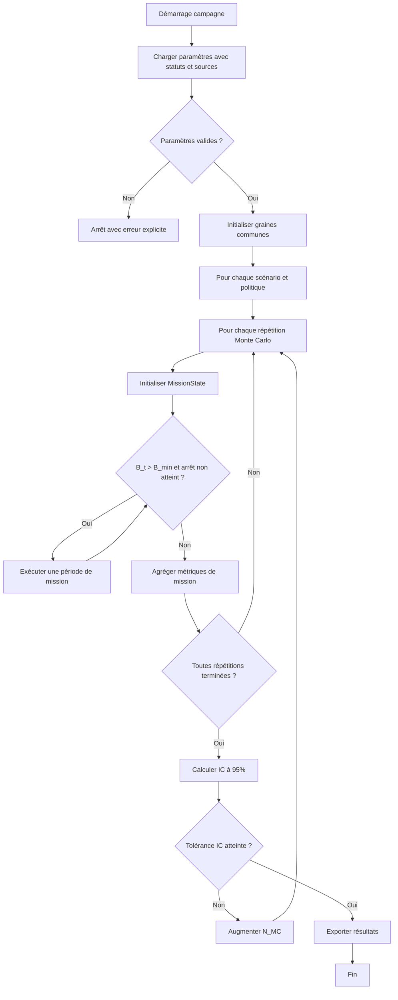
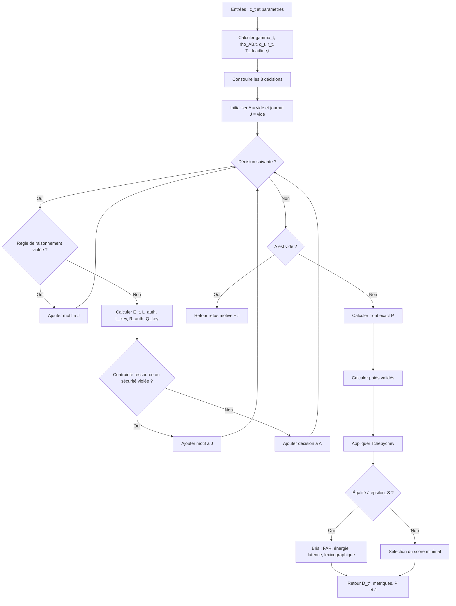

# Flux algorithmique officiel de PHYSEC-DM

## 1. Source de vérité

Ce flowchart reprend les deux algorithmes du dernier fichier de modélisation :

```text
Algorithme 1 : Decision Maker au temps t
Algorithme 2 : Mission d’Alice et processus d’attaque séparé
```

---

## 2. Flux global



---

## 3. Construction du contexte

À la période \(t\), construire :

```text
Gamma_t
gamma_t
f_d,t
rho_AB,t
B_t
age de clé
nombre de messages avec la clé
criticité sigma_t
budget duty-cycle
disponibilité RFF
compromission/suspicion
q_t
r_t
e_key,t
T_deadline,t
```

---

## 4. Production du SNR

```mermaid
flowchart TD
    A[Début canal] --> B{Mode SNR}
    B -- Imposé --> C[Gamma_t = mu_Gamma + X_sh,t]
    C --> D[gamma_t = 10^(Gamma_t/10)]

    B -- Distance --> E[Calcul PL(d)]
    E --> F[Calcul P_rx,t]
    F --> G[Calcul P_N]
    G --> H[Gamma_t = P_rx,t - P_N]
    H --> D

    D --> I[Calcul f_d,t]
    I --> J[rho_time = J0(2 pi f_d,t Delta_t)]
    D --> K[rho_noise = gamma_t / (1 + gamma_t)]
    J --> L[rho_AB = rho_HW * rho_time * rho_noise]
    K --> L
    L --> M[Retour ChannelMetrics]
```

Les deux modes de SNR sont exclusifs dans une expérience.

---

## 5. Fonctionnement du Decision Maker



---

## 6. Construction des huit décisions

```text
pour A dans [A1, A2]:
    pour K dans [K0, K1a, K1b, K2]:
        créer (A, K)
```

Invariant :

```text
len(decisions) == 8
```

---

## 7. Évaluation de A1

```text
p_forge = 2^(-b_MAC)
R_auth(A1) = 1 - p_forge
```

Coût :

```text
E_sec(A1) =
    E_MAC
    + E_tx(M_data + M_tag)
    - E_tx(M_data)

L_auth(A1) =
    T_MAC
    + T_air(M_data + M_tag)
    - T_air(M_data)
```

---

## 8. Évaluation de A2

### 8.1. RFF

```text
construire lambda_M,t
calculer FRR(theta)
calculer FAR(theta, lambda_M,t)
```

### 8.2. Robustesse complète

```text
P_FA(A2) =
    FAR
    + (1 - FAR) * 2^(-b_MAC)

R_auth(A2) =
    1 - P_FA(A2)
```

### 8.3. Repli légitime

```text
p_fb^(A) = FRR
```

### 8.4. Coût attendu d’Alice

```text
E_sec(A2) = FRR * E_CR

L_auth(A2) =
    T_RFF,Bob
    + FRR * L_CR
```

### 8.5. Admissibilité prudente

Pour les contraintes, employer :

```text
T_RFF,Bob + L_CR
```

comme pire cas de latence.

---

## 9. Évaluation de la génération de clé

### 9.1. KDR

```text
KDR_brut = arccos(rho_AB) / pi
```

Mode :

```text
analytique : KDR = KDR_brut
calibré    : KDR = g_q(rho_AB ; beta_q)
```

### 9.2. Rendement

```text
h2 = entropie binaire
y_rec = eta_keep * (1 - h2(KDR))
N_meas = ceil(key_length_bits / max(y_rec, epsilon))
```

### 9.3. Faisabilité

```text
phi_agree = 1 si KDR <= KDR_max
phi_PHY = phi_agree * phi_var
```

Tant que `phi_var` n’est pas validée, journaliser clairement que seule la faisabilité d’accord est établie.

---

## 10. Évaluation de la cryptopériode

```text
u_time = min(1, key_age / maximum_key_age)
u_msg  = min(1, messages_with_key / maximum_messages)
q_t    = max(u_time, u_msg)
```

```text
r_t = 1 si q_t >= q_trigger
```

```text
e_key,t = 1 si :
    age >= maximum_age
    ou messages >= maximum_messages
    ou compromission/suspicion
```

Échéance :

```text
T_age = max(maximum_age - age, 0)
T_msg = max(maximum_messages - messages, 0) * T_msg_period
T_deadline = max(T_min, min(T_age, T_msg))
```

---

## 11. Règles de raisonnement

Ces règles sont appliquées avant les contraintes numériques.

```text
A2 autorisée seulement si profil RFF disponible.
```

```text
r_t = 0 implique K_i = K0.
```

```text
r_t = 1 implique K_i != K0.
```

Lorsque la clé est expirée, `K0` est interdit.

---

## 12. Contraintes d’admissibilité

### 12.1. Faisabilité PHY

```text
K1a ou K1b implique phi_PHY = 1
```

### 12.2. Batterie

\[
E_t(D)\leq B_t-B_{\min}
\]

### 12.3. Authentification

\[
L_t^{\mathrm{auth}}(D)\leq L_{\max}(\sigma_t)
\]

### 12.4. Clé

\[
L_t^{\mathrm{key}}(D)\leq T_t^{\mathrm{deadline}}
\]

### 12.5. Duty-cycle

\[
T_{\mathrm{air},t}(D)\leq\tau_t^{\mathrm{duty}}
\]

### 12.6. Plancher de sécurité

\[
\mathrm{FAR}_t(D)\leq\mathrm{FAR}_{\max}(\sigma_t)
\]

Pour la contrainte :

```text
A1 : FAR = 2^(-b_MAC)
A2 : FAR = FAR RFF de l’équation 33
```

La robustesse complète A2 reste calculée avec le repli.

---

## 13. Objectifs

Pour chaque décision admissible :

\[
\mathbf f_t(D)
=
\begin{bmatrix}
E_t(D)\\
L_t(D)\\
-R_t^{\mathrm{auth}}(D)\\
-Q_t^{\mathrm{key}}(D)
\end{bmatrix}
\]

avec :

\[
L_t(D)
=
\max
\left(
\frac{L_t^{\mathrm{auth}}(D)}{L_{\max}(\sigma_t)},
\frac{L_t^{\mathrm{key}}(D)}{T_t^{\mathrm{deadline}}}
\right)
\]

---

## 14. Pareto exact

```text
pour chaque décision admissible D:
    dominée = faux

    pour chaque autre décision D2:
        si D2 n’est pas moins bonne sur tous les objectifs
        et strictement meilleure sur au moins un:
            dominée = vrai

    si non dominée:
        ajouter D au front
```

Avec huit décisions, la complexité exhaustive est suffisante.

---

## 15. Tchebychev

Pour chaque décision du front :

```text
normaliser chaque objectif entre point idéal et nadir
multiplier par le poids contextuel
prendre le maximum
```

Sélectionner le plus petit score.

Les poids doivent vérifier :

```text
w_k >= 0
somme(w_k) = 1
```

---

## 16. Bris d’égalité

À une tolérance \(\epsilon_S\) :

```text
1. plus faible FAR
2. plus faible énergie
3. plus faible latence bloquante
4. ordre lexicographique
```

---

## 17. Flux complet d’une période de mission

```mermaid
flowchart TD
    A[Début période t] --> B[Générer/estimer Gamma_t, f_d,t et sigma_t]
    B --> C[Construire c_t]
    C --> D[Appeler Decision Maker]
    D --> E{Message légitime servi ?}
    E -- Oui --> F[Débiter E_base + E_sec(D*)]
    F --> G[Mettre à jour clé et compteurs]
    E -- Non --> H[Débiter seulement les coûts réellement engagés]
    H --> I[Incrémenter N_ref]
    G --> J[Tirer tentative Mallory selon p_M]
    I --> J
    J --> K{Mallory tente ?}
    K -- Oui --> L[Évaluer chez Bob sans débiter Alice]
    L --> M[Mettre à jour N_M, N_FA et critiques]
    K -- Non --> N[Aucun compteur d’attaque]
    M --> O[Vérifier décision au SNR réel et N_viol]
    N --> O
    O --> P[Avancer t]
    P --> Q[Fin période]
```

---

## 18. Mise à jour de l’énergie

### Message servi

```text
débit =
    E_base,t
    + E_sec,t(D*)
```

### Refus

```text
débit =
    uniquement les opérations réellement exécutées avant le refus
```

### Mallory

```text
débit Alice = 0
```

---

## 19. Mise à jour de la clé

### K0

```text
âge += période écoulée
messages += 1 si message protégé
```

### K1a, K1b ou K2 réussie

```text
âge = 0
messages = 0
nouvel identifiant de clé
```

Le résultat doit enregistrer l’action et le succès réel.

---

## 20. Politiques de référence

Les campagnes doivent comparer au minimum :

```text
B1 : authentification et renouvellement conventionnels
B2 : PhySec naïve sans plancher
B3 : règle hybride fixe non adaptative
B4 : DM sans plancher de FAR
```

Toutes les politiques reçoivent :

- les mêmes traces radio ;
- les mêmes messages ;
- les mêmes attaques ;
- les mêmes graines ;
- les mêmes coûts de base.

---

## 21. Balayages déterministes

Avant la mission :

```text
1. SNR → FAR, FRR, EER
2. (Gamma, f_d) → rho_AB, KDR
3. comparaison des coûts
4. fronts de Pareto de contextes types
5. carte de décision selon SNR, batterie, criticité et âge de clé
```

---

## 22. Monte Carlo

Pour chaque scénario :

```text
utiliser des graines s_1, ..., s_NMC
communes à toutes les politiques
```

Augmenter \(N_{\mathrm{MC}}\) jusqu’à ce que la demi-largeur de l’intervalle de confiance à 95 % soit inférieure à la tolérance choisie.

---

## 23. Sensibilité

Balayer au minimum :

```text
mu_Gamma
sigma_sh
f_d
d_M
kappa_gb
q_trigger
p_C
p_M
T_msg
C_B
Delta_Gamma
poids w_k
rho_HW
```

---

## 24. Cas limites obligatoires

```text
SNR très faible
SNR très élevé
rho_AB négative
rho_AB proche de 1
KDR = KDR_max
batterie proche de B_min
q_t proche de 1
clé expirée
profil RFF absent
aucune décision admissible
front à une décision
égalité de scores
duty-cycle épuisé
```

---

## 25. Invariants du flowchart

```text
Les huit décisions sont évaluées avant Pareto.
```

```text
Les règles logiques précèdent les contraintes.
```

```text
Les contraintes précèdent Pareto.
```

```text
Pareto précède Tchebychev.
```

```text
L’état est mis à jour après la décision finale.
```

```text
Mallory est évaluée après le traitement légitime et séparément.
```

```text
Aucune attaque de Mallory ne débite Alice.
```

```text
Tout refus est motivé.
```

```text
Toute variante est enregistrée.
```

---

## 26. Pseudocode officiel du Decision Maker

```text
fonction run_decision_maker(c_t, paramètres):

    calculer gamma_t, rho_AB,t, q_t, r_t, T_deadline,t

    décisions = construire les huit décisions
    admissibles = []
    journal = []

    pour chaque D dans décisions:

        si D viole une règle de raisonnement:
            journaliser le motif
            continuer

        auth = évaluer l’authentification de D
        key = évaluer la gestion de clé de D
        cost = calculer les coûts de D

        calculer:
            E_t
            L_auth,t
            L_key,t
            R_auth,t
            Q_key,t
            FAR de contrainte

        si D viole une contrainte:
            journaliser chaque motif
            continuer

        ajouter D aux admissibles

    si admissibles est vide:
        retourner refus motivé

    front = calculer le front exact
    poids = calculer les poids validés
    scores = appliquer Tchebychev sur le front

    sélectionner le score minimal

    si égalité:
        appliquer le bris déterministe

    retourner:
        décision
        métriques
        front
        poids
        scores
        journal
```

---

## 27. Pseudocode officiel de la mission

```text
fonction run_mission(paramètres, politique, seed):

    initialiser état et générateur

    tant que batterie > réserve et arrêt non atteint:

        générer/estimer Gamma_t, f_d,t et criticité
        construire le contexte
        résultat_dm = appeler le Decision Maker

        si message légitime servi:
            débiter E_base + E_sec
            mettre à jour clé
        sinon:
            débiter seulement les coûts engagés
            incrémenter N_ref

        tirer indépendamment une tentative Mallory

        si tentative:
            évaluer chez Bob
            mettre à jour N_M et N_FA
            ne pas débiter Alice

        vérifier la décision au SNR réel
        mettre à jour N_viol
        avancer la période

    agréger les métriques
    retourner MissionResult
```